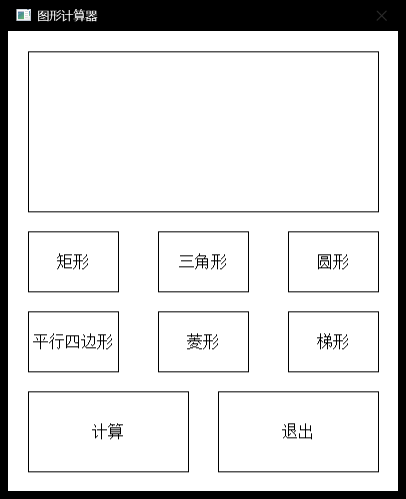

# ShapeCalc · 图形计算器

> 基于 C++ / EasyX 的桌面几何计算工具 —— 覆盖 15 类平面与立体图形的 44 项数值计算，并支持手绘任意多边形测量面积。

<p align="center">
  
</p>

## 简介

ShapeCalc 是一个轻量的 Windows 桌面图形计算工具。它把分散在教材各章节的几何公式收敛到同一个界面里：选择图形、填入尺寸、按回车，即可同时得到面积、周长、体积、表面积、对角线、内切/外接圆半径等彼此关联的指标，避免逐个公式手工推导与单位混乱。

除规则图形外，程序内置一个网格手绘画布，可以用鼠标逐点描出任意多边形，由鞋带公式实时解算面积与周长，适合处理无法归入标准形状的不规则区域。

项目以**单文件 C++ 源码**交付，不引入 MFC / Qt 等重型框架，界面完全由 Win32 GDI 手工绘制，双击仓库内的脚本即可完成编译与运行。

## 特性

- **15 类图形 / 44 项指标** —— 平面 9 类（矩形、正方形、三角形、圆形、平行四边形、菱形、梯形、扇形、椭圆）+ 立体 6 类（长方体、正方体、圆柱、圆锥、球、圆台）
- **手绘不规则多边形** —— 网格吸附落点、点击起点闭合、右键逐点撤销，鞋带公式实时出面积与周长
- **零弹窗输入** —— 点击图形后直接键盘录入，`Tab` 切换字段、`Enter` 计算、`Esc` 清空
- **字段级校验** —— 参数非法时对应输入框标红，并给出具体原因（如「三边无法构成三角形」）
- **表驱动架构** —— 新增一种图形只需写 1 个计算函数 + 添加 1 行表项，无需改动界面与事件代码
- **自绘 UI 层** —— 渐变背景、圆角卡片与投影、悬停颜色过渡，双缓冲 + 脏标记渲染，空闲零重绘
- **一键构建** —— 脚本自动探测 Visual Studio 工具链，缺失 SDK 路径时自动兜底，零配置即可编译运行

## 版本说明

仓库保留两个版本，源码独立、互不依赖，便于对比同一项目的演进过程。

| | **v1（初始版）** | **v2（重构版）** |
|---|---|---|
| 目录 | [`src/v1`](src/v1) | [`src/v2`](src/v2) |
| 代码规模 | 233 行 | 1296 行 |
| 图形类型 | 6 类（矩形、三角形、圆形、平行四边形、菱形、梯形） | 15 类规则图形 + 手绘多边形 |
| 计算指标 | 每图形 1 项（面积） | 44 项（面积/周长/体积/表面积/侧面积/对角线/内切外接圆半径/中位线/弧长/母线/直径） |
| 界面 | 390×460 单页按钮面板 | 920×620 分栏布局，渐变与圆角卡片 |
| 输入方式 | 连续弹窗（每参数一次 `InputBox`） | 表单纯键盘输入，`Tab`/`Enter`/`Esc` |
| 架构 | 6 个平行计算函数 + 硬编码按钮坐标 | `ShapeDef` 描述表 + 函数指针，数据驱动渲染 |
| 编译告警 | 2 条 `C4244` | 0 错误 / 0 警告 |
| 适用场景 | 原始作业留档、功能基线对照 | 日常使用、二次开发起点 |

<p align="center">
  
  &nbsp;&nbsp;&nbsp;
  
</p>

差异的详细成因与取舍见 [docs/04-versions.md](docs/04-versions.md)。

## 快速开始

### 环境要求

| 项目 | 要求 |
|---|---|
| 操作系统 | Windows 10 / 11（x64 或 x86） |
| 编译器 | Visual Studio 2019 / 2022 / 2026，需勾选「使用 C++ 的桌面开发」 |
| Windows SDK | 随 VS 工作负载安装（缺失时脚本会尝试自动补齐路径） |
| EasyX | 已随仓库置于 `third_party/easyx`，**无需另行安装** |

### 运行

```bat
:: 编译并运行 v2
cd src\v2
run.bat

:: 只编译，不运行
run.bat build

:: 编译 32 位版本
run.bat x86

:: 清理后重新编译
run.bat clean
```

v1 同理，进入 `src/v1` 执行 `run.bat`。编译产物输出到各自目录下的 `build\ShapeCalc.exe`。

> 脚本通过相对路径引用 `third_party/easyx`，请保持仓库目录结构完整，不要单独移动版本目录。

手动编译命令与排错指引见 [docs/05-build.md](docs/05-build.md)。

## 目录结构

```
shape-calculator/
├─ src/
│  ├─ v1/                    # 初始版本（6 类图形，单指标）
│  │  ├─ ShapeCalc.cpp
│  │  ├─ run.bat             # 一键编译运行
│  │  └─ README.md
│  └─ v2/                    # 重构版本（15 类图形 + 手绘）
│     ├─ ShapeCalc.cpp
│     ├─ run.bat
│     └─ README.md
├─ third_party/
│  └─ easyx/                 # EasyX 图形库（两版共用）
│     ├─ include/            #   easyx.h / graphics.h
│     └─ lib/{x64,x86}/      #   EasyXa.lib / EasyXw.lib
├─ docs/                     # 项目文档
│  ├─ 01-overview.md         #   项目概述与定位
│  ├─ 02-features.md         #   功能清单与公式说明
│  ├─ 03-architecture.md     #   架构与实现细节
│  ├─ 04-versions.md         #   版本演进与差异
│  ├─ 05-build.md            #   构建、运行与排错
│  └─ 06-engineering-notes.md#   工程笔记（问题定位与解决）
├─ resources/
│  └─ screenshots/           # 界面截图
├─ .gitattributes            # 源码编码与换行策略
├─ .gitignore
├─ LICENSE
└─ README.md
```

## 技术栈

`C++` · `EasyX 4.x（Win32 GDI）` · `MSVC 14.x` · `Windows SDK 10` · `Windows Batch`

## 文档索引

| 文档 | 内容 |
|---|---|
| [01-overview.md](docs/01-overview.md) | 项目定位、目标场景、解决的问题 |
| [02-features.md](docs/02-features.md) | 全部图形、参数、输出指标与所用公式 |
| [03-architecture.md](docs/03-architecture.md) | 表驱动结构、渲染层、事件层、几何算法 |
| [04-versions.md](docs/04-versions.md) | v1 与 v2 的逐项对比及演进动因 |
| [05-build.md](docs/05-build.md) | 构建流程、参数说明、常见报错处理 |
| [06-engineering-notes.md](docs/06-engineering-notes.md) | 字体渲染、库本地化、公式缺陷等攻关记录 |

## 已知限制

- 源码为 **GBK 编码**、按多字节字符集（非 Unicode）编译，以兼容 EasyX 的窄字符接口；在非中文代码页环境下直接编译可能出现中文乱码，仓库已通过 `.gitattributes` 的 `working-tree-encoding` 保证 GitHub 端显示正常。
- 手绘模式落点吸附到网格交点，面积精度取决于网格密度（当前 1 格 = 1 单位）。
- 仅支持凸多边形与简单多边形；自交多边形按鞋带公式代数面积计算，可能出现非预期结果。
- 未实现小数位数配置、单位换算与历史记录功能。

## 许可

[MIT License](LICENSE)

---

<sub>Maintained by **Zero** · 2026</sub>
