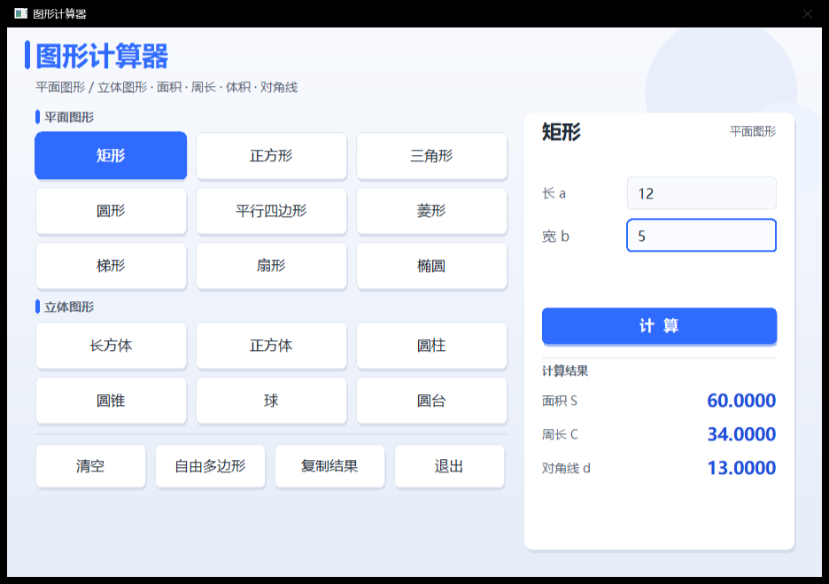

# v2 · 重构版本

> ShapeCalc 的当前版本：15 类规则图形共 44 项指标 + 手绘不规则多边形，表驱动架构与自绘 UI。

<p align="center">
  
</p>

## 功能范围

**平面图形（9 类）**：矩形、正方形、三角形、圆形、平行四边形、菱形、梯形、扇形、椭圆
**立体图形（6 类）**：长方体、正方体、圆柱、圆锥、球、圆台
**手绘模式**：网格画布逐点描绘任意多边形，鞋带公式实时解算面积与周长

每个图形输出面积、周长、体积、表面积、侧面积、对角线、内切/外接圆半径、中位线、弧长、母线、直径等指标中的数项，合计 44 项。完整参数与公式见 [docs/02-features.md](../../docs/02-features.md)。

## 运行

```bat
cd src\v2
run.bat              :: 编译并运行
run.bat build        :: 只编译
run.bat x86          :: 32 位
run.bat clean        :: 清理重编
```

需要 Visual Studio 的 C++ 桌面开发工作负载；EasyX 库位于仓库 `third_party/easyx`，无需单独安装。

## 交互

选定图形后无需鼠标，全键盘操作：

| 键 | 作用 |
|---|---|
| `0-9` `.` | 录入参数（限数字与单个小数点） |
| `Backspace` | 删除末位 |
| `Tab` | 切换到下一个参数 |
| `Enter` | 计算 |
| `Esc` | 清空重填 |

手绘模式下：左键落点、点击橙色起点闭合、右键撤销、`Esc` 清空。

参数非法时对应输入框标红并给出中文原因，不会输出 `nan` 或负数。

## 实现要点

| 要点 | 说明 |
|---|---|
| 表驱动 | `ShapeDef` 描述表 + 函数指针；新增图形只需 1 个计算函数 + 1 行表项，界面与事件代码零改动 |
| 自绘 UI | 不使用 MFC/Qt，渐变背景、圆角卡片、投影、悬停过渡全部由 GDI 手绘 |
| 渲染策略 | 双缓冲 + 脏标记，仅在状态变化或动画未收敛时重绘，空闲零重绘 |
| 状态收敛 | 全局参数数组改为 `g_inputs` / `g_results` / `g_pts` 三组结构化状态 |
| 退出方式 | 置 `running = false` 正常退出并 `closegraph()`，不再 `exit(0)` |
| 编译状态 | `/W3` 下 0 错误 / 0 警告 |

架构细节见 [docs/03-architecture.md](../../docs/03-architecture.md)，开发中的问题定位记录见 [docs/06-engineering-notes.md](../../docs/06-engineering-notes.md)。

## 与 v1 的关系

v2 不是 v1 的分支演进，而是重新组织后的实现：计算函数语义保持一致（除修正菱形公式），界面、输入流程、状态管理与扩展方式全部重写。两版可分别编译，结果可互相校验。差异对照见 [docs/04-versions.md](../../docs/04-versions.md)。

---

<sub>Zero · 2026</sub>
